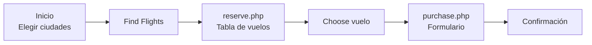
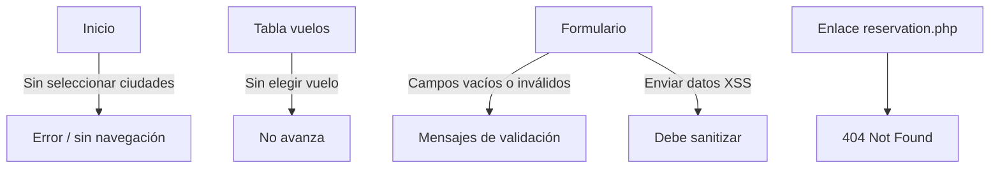

# 📘 Base de Conocimiento — BlazeDemo.com

> **Propósito de este documento:** ser la referencia única y estructurada para cualquier
> QA que se incorpore al equipo y necesite entender, probar o automatizar el sitio
> BlazeDemo.com. Cada sección responde una pregunta concreta que un QA nuevo se hace.

---

## 📑 Índice

1. [Resumen ejecutivo](#1-resumen-ejecutivo)
2. [Ficha técnica del sistema](#2-ficha-técnica-del-sistema)
3. [Glosario para QA nuevo](#3-glosario-para-qa-nuevo)
4. [Arquitectura del sitio (mapa de páginas)](#4-arquitectura-del-sitio-mapa-de-páginas)
5. [Flujos de usuario](#5-flujos-de-usuario)
6. [Inventario de elementos y datos](#6-inventario-de-elementos-y-datos)
7. [Reglas de negocio identificadas](#7-reglas-de-negocio-identificadas)
8. [Defectos y peculiaridades conocidas](#8-defectos-y-peculiaridades-conocidas)
9. [Estrategia de pruebas](#9-estrategia-de-pruebas)
10. [Casos de prueba](#10-casos-de-prueba)
11. [Guía de automatización recomendada](#11-guía-de-automatización-recomendada)
12. [FAQ del QA nuevo](#12-faq-del-qa-nuevo)
13. [Checklist onboarding](#13-checklist-onboarding)
14. [Referencias y recursos](#14-referencias-y-recursos)
15. [Control de versiones del documento](#15-control-de-versiones-del-documento)

---

## 1. Resumen ejecutivo

**BlazeDemo.com** es un sitio web *demo* gratuito creado por **BlazeMeter** como
entorno de práctica para aprender pruebas manuales y de automatización.

| Pregunta | Respuesta |
|---|---|
| ¿Es un producto real? | No. Es un simulador de agencia de viajes con datos falsos. |
| ¿Guarda información? | No. No hay backend persistente; nada se guarda entre sesiones. |
| ¿Para qué sirve? | Practicar pruebas funcionales, validación de formularios, tablas dinámicas, cálculos y automatización (Selenium/Playwright/Cypress). |
| ¿Por qué lo usamos? | Datos predecibles + flujo completo (selección → resultados → compra) = escenario ideal para onboarding de QA nuevos. |
| ¿Riesgo de impacto? | Cero. No afecta a ningún cliente ni sistema productivo. |

**Flujo en una frase:** el usuario elige ciudad de origen y destino, selecciona un
vuelo de una tabla aleatoria, completa un formulario de pasajero/pago y "compra" el billete.

---

## 2. Ficha técnica del sistema

| Atributo | Detalle |
|---|---|
| URL base | `https://blazedemo.com` |
| Protocolo | HTTPS |
| Tecnología detectada | PHP (`.php`) + HTML estático (`.html`) |
| Base de datos | Ninguna (datos aleatorios generados por sesión) |
| Autenticación | **No funcional**: `/login`, `/register` y `/password/reset` son scaffolding Laravel (Breeze); GET 200, POST → **419 Page Expired** (CSRF). El enlace de menú "home" redirige a `/login` (ver BUG-06) |
| API REST/GraphQL | No expuesta |
| Responsive | Parcial (ver TC-NF-02) |
| Idioma | Inglés |
| Licencia de uso | Demo libre para práctica |

---

## 3. Glosario para QA nuevo

| Término | Definición sencilla | Ejemplo en BlazeDemo |
|---|---|---|
| **Sitio demo** | Página de práctica con datos falsos | Todo BlazeDemo |
| **Flujo happy path** | El camino ideal donde todo sale bien | Elegir vuelo → comprar sin errores |
| **Caso de prueba (TC)** | Paso a paso con resultado esperado | Ver sección 10 |
| **Validación de campos** | Comprobar que el formulario rechaza datos inválidos | Zip = "abc" debe fallar |
| **Tabla dinámica** | Contenido que cambia en cada carga | Resultados de vuelos aleatorios |
| **Asersión (assertion)** | Verificación automatizada de un resultado | `Total = Precio + Tasas` |
| **XSS** | Inyección de scripts maliciosos en campos de texto | `<script>alert(1)</script>` en Name |
| **Broken link** | Enlace que devuelve error (404) | `reservation.php` |
| **Boundary testing** | Probar límites de datos | Nombre de 255 vs 256 caracteres |
| **Regression testing** | Re-ejecutar pruebas tras un cambio | Tras cada actualización del sitio |

---

## 4. Arquitectura del sitio (mapa de páginas)

```
blazedemo.com
│
├── index.php /  ──────────── PÁGINA 1: Inicio (selección de ciudades)
│   └── (POST) ──────────────▶ reserve.php
│
├── reserve.php ───────────── PÁGINA 2: Resultados (tabla de vuelos)
│   └── (click "Choose") ───▶ purchase.php
│
├── purchase.php ──────────── PÁGINA 3: Compra (formulario pasajero/pago)
│
├── vacation.html ─────────── PÁGINA 4: Vacación (estática, "Destination of the week")
│
├── home ──────────────────── PÁGINA 5: Home alternativo (duplicado del inicio)
│
└── reservation.php ⚠️ 404 ── ENLACE ROTO (no existe; el correcto es reserve.php)
```

| # | Página | URL | Tipo | Rol en el flujo |
|---|---|---|---|---|
| 1 | Inicio | `/index.php` | PHP + form | Entrada: elegir ciudades |
| 2 | Resultados | `/reserve.php` | PHP + tabla | Elegir vuelo |
| 3 | Compra | `/purchase.php` | PHP + form | Pasajero + pago |
| 4 | Vacación | `/vacation.html` | HTML estático | Contenido decorativo |
| 5 | Home alt. | `/home` | HTML | Duplicado del inicio |

---

## 5. Flujos de usuario

### 5.1 Flujo principal (Happy Path)



### 5.2 Flujo alternativo / error



### 5.3 Secuencia de pasos (script manual de referencia)

```
1. Abrir https://blazedemo.com
2. Seleccionar origen: Boston
3. Seleccionar destino: Rome
4. Clic "Find Flights"
5. Verificar tabla con ≥5 filas
6. Clic "Choose" en la primera fila
7. Verificar datos del vuelo en purchase.php
8. Verificar: Total = Price + Arbitrary Fees and Taxes
9. Enviar formulario vacío → esperar errores de validación
10. Rellenar datos válidos → esperar confirmación
11. Volver atrás → verificar que NO se persistió ningún dato
```

---

## 6. Inventario de elementos y datos

### 6.1 Página de Inicio

**Dropdown — Origen (7 opciones):**
`Paris` · `Philadelphia` · `Boston` · `Portland` · `San Diego` · `Mexico City` · `São Paolo`

**Dropdown — Destino (13 opciones):**
`Buenos Aires` · `Rome` · `London` · `Berlin` · `New York` · `Dublin` · `Cairo`
(+ las 7 del origen)

**Botón:** `Find Flights`
**Nota QA:** valor por defecto de ambos dropdowns = `Choose` (debe bloquearse o validarse).

### 6.2 Página de Resultados (reserve.php)

| Columna | Tipo de dato | Ejemplo | Regla de validación |
|---|---|---|---|
| Flight # | Entero | `43`, `9696` | > 0, numérico |
| Airline | Texto | `Virgin America` | No vacío |
| Departs | Hora | `1:43 AM` | Formato 12h válido |
| Arrives | Hora | `9:45 PM` | Formato 12h válido |
| Price | Moneda | `$472.56` | Formato `$X.XX`, > 0 |
| Choose | Botón | — | Navega a `purchase.php` |

- La tabla muestra **5 filas** con datos **aleatorios en cada consulta**.

### 6.3 Página de Compra (purchase.php)

**Cabecera (resumen del vuelo):**

| Campo | Ejemplo | Nota |
|---|---|---|
| Airline | United | |
| Flight Number | UA954 | |
| Price | 400 | |
| Arbitrary Fees and Taxes | 514.76 | |
| **Total Cost** | **914.76** | = Price + Fees ⚠️ verificar siempre |

**Formulario:**

| Campo | Tipo | Obligatorio esperado | Datos de prueba sugeridos |
|---|---|---|---|
| Name | Texto | Sí | `Ana Test` |
| Address | Texto | Sí | `Calle Falsa 123` |
| City | Texto | Sí | `Madrid` |
| State | Texto | Sí | `MD` |
| Zip Code | Numérico | Sí | `28001` / inválido: `abc` |
| Card Type | Select | Sí | Visa / American Express / Diner's Club |
| Credit Card Number | Numérico | Sí | `4111111111111111` (Visa test) |
| Month | Select | Sí | Mes futuro |
| Year | Select | Sí | Año futuro |
| Name on Card | Texto | Sí | `ANA TEST` |
| Remember me | Checkbox | No | Marcar / desmarcar |

---

## 7. Reglas de negocio identificadas

| ID | Regla | Cómo verificarla |
|---|---|---|
| RN-01 | `Total Cost = Price + Arbitrary Fees and Taxes` | TC-07: 400 + 514.76 = 914.76 ✓ |
| RN-02 | Debe haber origen ≠ destino (implícito) | TC-03: mismo origen y destino |
| RN-03 | Solo 3 tipos de tarjeta admitidos | TC-10: comprobar opciones del select |
| RN-04 | El vuelo elegido se "reserva" antes de comprar | TC-04: verificar continuidad de datos entre páginas |
| RN-05 | Los resultados de vuelos son aleatorios | TC-06: dos búsquedas seguidas → datos distintos |
| RN-06 | No hay persistencia de la compra | TC-14: recargar/volver → datos perdidos |

---

## 8. Defectos y peculiaridades conocidas

> ⚠️ Estado: **abiertos / aceptados** al 2026-10-07. Reportar de nuevo si cambian.

| ID | Severidad | Descripción | Evidencia | Tratamiento |
|---|---|---|---|---|
| BUG-01 | Media | Enlace roto `reservation.php` → **404** (el correcto es `reserve.php`) | GET `/reservation.php` = 404 | Known issue; usar en prueba de broken links |
| BUG-02 | Media | Cabecera de compra muestra ruta incorrecta ("TLV to SFO" en vez de ciudades elegidas) | `purchase.php` | Bug real → candidato a reporte |
| BUG-03 | Baja | Mezcla de tecnologías `.php` y `.html` | Inventario sección 4 | Particularidad, no es bug |
| BUG-04 | Baja | Datos aleatorios impiden asersión hard-coded | Tabla de vuelos | Diseño intencional |
| BUG-05 | Info | No hay backend: nada se persiste | — | Diseño intencional |
| BUG-06 | Media | El enlace de menú **`home`** (href `home`) responde 200 pero **redirige a `/login`** (pantalla de login/registro de la app), no a un "home" visible | GET `/home` → final URL `/login` (title "BlazeDemo") | Documentar como peculiaridad; en tests aceptar `/home` o `/login`. Verificado 2026-10-09 |

---

## 9. Estrategia de pruebas

### 9.1 Enfoque por tipo de prueba

| Tipo de prueba | ¿Aplica? | Foco en BlazeDemo |
|---|---|---|
| Funcional | ✅ Sí | Flujos completos, navegación, cálculos |
| Validación de formularios | ✅ Sí (principal) | Campos vacíos, formatos, límites |
| UI / Visual | ✅ Sí | Layout, tablas, dropdowns |
| Regresión | ✅ Sí | Tras cada cambio en el sitio |
| Compatibilidad / Cross-browser | ✅ Sí | Chrome, Firefox, Edge |
| Responsive | ⚠️ Parcial | Móvil/tablet |
| Rendimiento | ⚠️ Opcional | Tiempo de carga < 3 s |
| Seguridad (básica) | ✅ Sí | XSS en campos de texto |
| Accesibilidad | ⚠️ Opcional | Labels, navegación por teclado |
| API / Backend | ❌ No | No hay API ni BD |
| Estrés / Carga | ❌ No | Sin backend real |
| Usabilidad | ✅ Sí | Claridad de mensajes y pasos |

### 9.2 Priorización (riesgo × valor)

1. **P0 —** Happy path completo (inicio → compra)
2. **P0 —** Validación de formulario de compra
3. **P1 —** Cálculo del Total Cost
4. **P1 —** Tabla de resultados (columnas, formato precio, navegación)
5. **P2 —** Enlaces y broken links
6. **P2 —** Cross-browser y responsive
7. **P3 —** Seguridad básica (XSS) y rendimiento

---

## 10. Casos de prueba

### 10.1 Funcionales

| ID | Título | Pasos | Resultado esperado | Prioridad |
|---|---|---|---|---|
| TC-01 | Happy path: compra completa | Elegir Boston→Rome → Find Flights → Choose 1er vuelo → rellenar form válido → submit | Confirmación mostrada | P0 |
| TC-02 | Submit sin seleccionar ciudades | Dejar ambos dropdowns en "Choose" → Find Flights | Validación o navegación controlada (sin crash) | P0 |
| TC-03 | Origen igual a destino | Seleccionar Paris en ambos → Find Flights | Comportamiento definido (error o 0 resultados) | P1 |
| TC-04 | Elegir vuelo mantiene datos | Choose en fila 3 → verificar purchase.php | Airline/Flight coinciden con la fila elegida | P0 |
| TC-05 | Formato de la tabla | Verificar columnas y filas | 5 filas, 5 columnas, precios `$X.XX` | P1 |
| TC-06 | Aleatoriedad de resultados | Buscar 2 veces el mismo trayecto | Datos distintos entre búsquedas | P2 |

### 10.2 Cálculos

| ID | Título | Pasos | Resultado esperado | Prioridad |
|---|---|---|---|---|
| TC-07 | Total = Precio + Tasas | Verificar fórmula en purchase.php | `400 + 514.76 = 914.76` exacto | P0 |
| TC-08 | Precio positivo | Revisar columna Price | Todos los precios > 0 y formato correcto | P1 |

### 10.3 Validación de formularios

| ID | Título | Datos de entrada | Resultado esperado | Prioridad |
|---|---|---|---|---|
| TC-09 | Formulario vacío | Todos los campos vacíos → submit | Errores en campos obligatorios, no navega | P0 |
| TC-10 | Selects de tarjeta | Verificar opciones Card Type | Solo Visa, Amex, Diner's Club | P1 |
| TC-11 | Zip inválido | Zip = `abc` / `--` | Error de validación | P1 |
| TC-12 | Tarjeta de crédito inválida | Card # = `1234` | Error de validación | P1 |
| TC-13 | Fecha de caducidad pasada | Month/Year en el pasado | Error (tarjeta expirada) | P1 |
| TC-14 | Sin persistencia | Comprar → recargar / volver | Datos no persistidos | P2 |
| TC-15 | Textos muy largos (boundary) | Name con 300 caracteres | Límite de campo respetado | P2 |
| TC-16 | Caracteres especiales | Name = `Ñandú & " < >` | Se muestran correctamente o se sanitizan | P2 |

### 10.4 No funcionales y seguridad

| ID | Título | Pasos | Resultado esperado | Prioridad |
|---|---|---|---|---|
| TC-NF-01 | Broken links | Rastrear todos los enlaces del sitio | Único fallo esperado: `reservation.php` → 404 | P2 |
| TC-NF-02 | Responsive | Abrir en 360px, 768px, 1920px | Layout usable sin scroll horizontal | P2 |
| TC-NF-03 | Cross-browser | Chrome, Firefox, Edge | Comportamiento idéntico | P2 |
| TC-NF-04 | Rendimiento | Medir carga de cada página | < 3 segundos | P3 |
| TC-NF-05 | XSS en campos | Name = `<script>alert(1)</script>` | Script NO se ejecuta | P2 |
| TC-NF-06 | Ruta incorrecta cabecera | Comprar vuelo y leer cabecera | Debería indicar ciudades elegidas (hoy muestra "TLV to SFO") → **BUG-02** | P2 |

---

## 11. Guía de automatización recomendada

### 11.1 Stack sugerido para un QA nuevo

| Nivel | Herramienta | Por qué |
|---|---|---|
| Web UI | **Playwright** (recomendado) o Selenium | Multi-browser, auto-wait, fácil de aprender |
| Lenguaje | **Python** o JavaScript/TypeScript | Curva de aprendizaje suave |
| Ejecución | `pytest` / Playwright Test runner | Reportes claros |
| CI (futuro) | GitHub Actions | Integración sencilla |

### 11.2 Primeros 5 tests a automatizar

```
1. smoke_home      → abre home, verifica título y 2 dropdowns con opciones correctas
2. search_flights  → selecciona ciudades, valida tabla (≥1 fila, formato precio)
3. choose_flight   → clic Choose, verifica continuidad de datos en purchase.php
4. total_calc      → asersión Total = Price + Fees
5. empty_form      → submit vacío, espera mensajes de error
```

### 11.3 Buenas prácticas (evitar los errores típicos)

- ❌ **No** hardcodear precios/vuelos → son aleatorios; usar regex/asersión numérica.
- ❌ **No** usar `sleep()` fijo → usar esperas explícitas (`waitForSelector`).
- ✅ **Sí** usar *Page Objects* desde el día 1 (separar localizadores de lógica).
- ✅ **Sí** parametrizar datos de prueba (ciudades, datos de tarjeta).
- ✅ **Sí** escribir asersiones con mensajes claros: `"Total esperado 914.76, real 900.00"`.

### 11.4 Ejemplo de asersión (Playwright, pseudocódigo)

```javascript
const price = 400, fees = 514.76;
const total = await page.locator('#totalCost').innerText();
expect(parseFloat(total)).toBeCloseTo(price + fees, 2);
```

---

## 12. FAQ del QA nuevo

**¿Necesito datos de acceso?**
No para el flujo principal. El login/registro de `/login` y `/register` es scaffolding no funcional (POST responde 419); el acceso público suficiente para el flujo de compra. El enlace "home" del menú lleva a `/login` (ver BUG-06).

**¿Por qué los vuelos cambian cada vez que recargo?**
Son aleatorios por diseño. Nunca asumas valores fijos; valida formato y relaciones.

**¿Dónde guardo los resultados de mis pruebas?**
En `exp003/` de tu workspace: este KB (`blazedemo-kb.md`) + tus scripts y reportes.

**¿Puedo romper el sitio probando?**
No. Es un entorno demo sin datos reales; puedes probar sin miedo.

**¿Qué hago si encuentro un bug nuevo?**
Primero busca en la sección 8. Si no está: reproduce, captura pantalla, anota
URL + pasos + esperado vs obtenido y repórtalo al equipo.

**¿Cuál es el bug más interesante para practicar un reporte?**
`BUG-02` (la cabecera dice "TLV to SFO" en vez de tus ciudades elegidas) es un
bug real, visible y fácil de documentar.

**¿Sirve para practicar automatización?**
Sí — es uno de los sitios más usados a nivel mundial para tutoriales de
Selenium/Playwright/Cypress.

---

## 13. Checklist onboarding (QA nuevo)

- [ ] Leo las secciones 1 a 6 de este KB
- [ ] Recorro el flujo happy path a mano (sección 5.3)
- [ ] Ejecuto los 8 casos P0/P1 de la sección 10
- [ ] Identifico al menos 1 bug nuevo o confirmo uno de la sección 8
- [ ] Configuro mi entorno de automatización (Playwright/Selenium)
- [ ] Escribo mi primer test automatizado (`smoke_home`)
- [ ] Ejecuto la suite completa y comparto resultados con el equipo
- [ ] Actualizo este KB si descubro algo nuevo (ver sección 15)

---

## 14. Referencias y recursos

| Recurso | URL |
|---|---|
| Sitio bajo prueba | https://blazedemo.com |
| Documentación BlazeMeter | https://www.blazemeter.com |
| Playwright docs | https://playwright.dev/docs/intro |
| Selenium docs | https://www.selenium.dev/documentation/ |
| Visa card de prueba | `4111 1111 1111 1111` |

---

## 15. Control de versiones del documento

| Versión | Fecha | Autor | Cambio |
|---|---|---|---|
| 1.0 | 2026-10-07 | Equipo de Calidad | Creación inicial del KB: estructura, flujos, 22 casos de prueba, bugs conocidos, estrategia y guía de automatización |

> **Regla de mantenimiento:** este KB se revisa cada sprint. Cualquier QA que
> añada un caso de prueba o descubra un defecto debe incrementar la versión
> y registrarlo en la tabla anterior.
